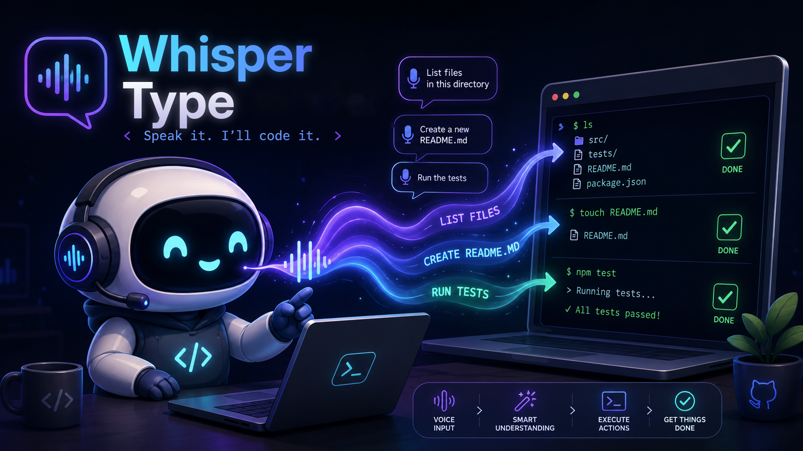

<div align="center">



<br>

**Voice input for developers: speak, transcribe in about a second, and paste at the cursor.**

[](#quick-start--linux--nvidia-gpu)
[](#how-it-works)
[](#configuration)
[](LICENSE)

[Install](#quick-start--linux--nvidia-gpu) • [How it works](#how-it-works) • [Status](#current-state)

</div>

## What is WhisperType

> *Speak instead of typing.*

WhisperType records speech, transcribes it, and pastes the result at the active cursor. By default it transcribes through OpenRouter; `whisper.cpp` and Parakeet run locally on an NVIDIA GPU when the audio must stay on the machine. The CLI alias remains **`vc`**.

It runs on Linux. Optional Gemini refinement can remove dictation noise. It can restructure the transcription before WhisperType pastes it.

**Proof available now:** the working Linux implementation, a reproducible source installer and a setup-check script.

The installer creates an isolated Python environment from [`requirements.lock`](requirements.lock). It builds a pinned `whisper.cpp` revision with CUDA. It downloads the expected model. It checks the model checksum. It tests the resulting runtime.

The installer also installs the `whispertype` and `vc` commands. It adds a launcher to the Applications menu. There is no prebuilt bundle today.

## Quick start — Linux + NVIDIA GPU

1. Clone the repository:

   ```bash
   git clone https://github.com/MasihMoafi/WhisperType.git
   ```

2. Enter the repository directory:

   ```bash
   cd WhisperType
   ```

3. Run the installer:

   ```bash
   ./install.sh
   ```

Check the local setup:

```bash
chmod +x Linux/test_setup.sh
./Linux/test_setup.sh
```

Start it from the Applications menu, or run either command:

```bash
whispertype
# Short form:
vc
```

The default backend is OpenRouter: the recorded audio is sent there for transcription. It needs `OPENROUTER_API_KEY_COMPANY`. `vc` and `vc1` use `openai/gpt-4o-mini-transcribe`; `vc2` uses `nvidia/parakeet-tdt-0.6b-v3`. On an 11-second clip the median time to text was 0.85 s and 1.25 s respectively (14 Oct 2026, one connection). Set `WHISPERTYPE_CLOUD_MODEL` to choose another model. Run `whispertype local` or `whispertype parakeet` for the local GPU engines, or set `WHISPERTYPE_BACKEND=local`.

Run `whispertype` alone for a menu. `whispertype status`, `whispertype stop` and `whispertype start --background` control one shared engine; a second engine is refused, so speech is never pasted twice. The Elpis desktop app's WhisperType section uses these same commands.

If your shell path excludes `~/.local/bin`, open a new terminal. You can also start `./run-whisper.sh` directly.

Press **F8**, **F9**, or **Right Ctrl** to start or stop recording.

Expected result: WhisperType copies the transcription. It pastes the transcription into the active application.

## Ultra-Fast Engine: Parakeet 0.6B (`vc2`)

For sub-second, ultra-fast local transcription on NVIDIA GPUs, WhisperType supports **parakeet.cpp** running the NVIDIA Parakeet TDT 0.6B model (`vc2`).

### Quick Setup (`vc2`)

```bash
bash parakeet-commander/setup.sh
python parakeet-commander/portable_commander_parakeet.py
```
*(Or invoke via your `vc2` shell alias).*

### Benchmark vs Whisper Medium (GPU)

Measured on NVIDIA RTX GPU using sequential audio dictation fixtures:

| Engine | Model | Parameters | Latency (30s audio) | Speedup | Accuracy (WER) |
|---|---|---|---|---|---|
| **Whisper.cpp** | `medium.en` | 769M | 4,821 ms | 1.0x (baseline) | High |
| **Parakeet.cpp (`vc2`)** | `tdt-0.6b-v2-f16` | 600M | **712 ms** | **6.77x faster** | **Whisper Large v3 level** |

To run the live benchmark suite locally:
```bash
python parakeet-commander/benchmark.py
```

## The problem

For long prompts, notes, and terminal instructions, typing can become the slowest part of getting an idea into an agent or editor. General dictation tools also tend to preserve filler words and transcription artifacts that are inconvenient in technical prompts.

WhisperType removes that specific friction by combining local speech-to-text with direct cursor insertion and optional post-processing.

## How it works

```text
microphone
   ↓
16 kHz audio capture
   ↓
OpenRouter (default)  or  whisper.cpp / Parakeet on the local GPU
   ↓
raw transcription
   ↓
optional Gemini refinement
   ↓
clipboard
   ↓
active terminal/editor
```

The current Linux implementation:

- It records microphone audio with `sounddevice`.
- By default it uploads the audio as FLAC to OpenRouter over a pre-warmed connection.
- The local engines invoke the locally built `whisper-cli` or `parakeet.cpp`. They require an NVIDIA GPU and do not silently use the CPU as a fallback.
- It can send the **transcribed text** to Gemini when you enable refinement.
- It pastes with `Ctrl+V` or `Ctrl+Shift+V`. The focused application and `VC_PASTE_MODE` determine the paste keys. On GNOME Wayland it reads the hotkeys through evdev and pastes through Mutter.

## Configuration

Copy the example environment file:

```bash
cp .env.example .env
```

For optional Gemini refinement:

```bash
GEMINI_API_KEY=your-api-key-here
VC_ENABLE_LLM=true
VC_LLM_FORMAT=xml
```

Supported output-format values in the current Linux script:

| Variable | Values | Purpose |
| --- | --- | --- |
| `VC_ENABLE_LLM` | `true` / `false` | Enable or disable Gemini post-processing |
| `VC_LLM_FORMAT` | `plain` / `xml` / `json` | Shape of refined text |
| `GEMINI_API_KEY` | API key | Required only when you enable refinement |
| `VC_PASTE_MODE` | `auto` / `ctrl_v` / `ctrl_shift_v` | Paste-key behavior |

Without `GEMINI_API_KEY`, the Linux implementation falls back to the local Whisper transcription.

## Current state

### Implemented

- Linux microphone recording and hotkey control, on X11 and GNOME Wayland.
- OpenRouter transcription (default) with `gpt-4o-mini-transcribe` or Parakeet TDT 0.6B v3.
- CUDA-backed local `whisper.cpp` transcription using `ggml-medium.en.bin`, and local Parakeet.
- The `whispertype` command: a menu, `status`, `stop`, `start --background`, and one shared engine at a time.
- Clipboard insertion into the active application.
- Terminal-aware paste-key selection on X11.
- Optional Gemini text refinement with plain/XML/JSON output modes.
- Local setup diagnostics in [`Linux/test_setup.sh`](Linux/test_setup.sh).

### Implemented but not continuously verified

- The repository has local diagnostic/test scripts, but no CI currently proves end-to-end microphone → Whisper → refinement → paste behavior on a clean machine.
- Desktop/window behavior depends on the local Linux environment. The terminal-detection helper is specifically X11-aware.

### Planned / unresolved

- A prebuilt binary/package. The source installer is reproducible, but still compiles `whisper.cpp` locally and downloads the model.
- Broader platform acceptance testing.
- Multi-language support.
- Additional refinement-provider options only when there is a maintained implementation path.

### Not claimed as supported today

- A small standalone binary/package.
- Verified macOS support.
- Verified Windows end-to-end support.
- CPU fallback in the primary Linux GPU script.

There are Windows-specific files in the repository, but this README does not present them as a verified release path without current acceptance evidence.

## What sets the design apart

These are implementation choices, not novelty claims:

- **Cloud or local transcription:** OpenRouter by default for speed; `whisper.cpp` or Parakeet on the local GPU when the audio must not leave the machine.
- **Optional refinement:** WhisperType sends only the transcription text to Gemini when you enable refinement.
- **Cursor-first workflow:** the design aims to place output where the developer is already typing. It aims to avoid a separate transcription UI.
- **Fail-closed GPU path:** the local GPU engines explicitly check for NVIDIA availability rather than silently changing execution mode.

## Evals and test series

Run the setup diagnostic:

```bash
./Linux/test_setup.sh
```

It checks Python, required Python imports, NVIDIA/CUDA availability, the compiled Whisper executable, and the expected model file.

What that proves: the required local pieces are present and the expected GPU executable/model paths exist.

What it does **not** prove: microphone quality, transcription accuracy, Gemini availability, paste behavior in every desktop environment, or cross-platform support.

`Linux/test_llm_integration.py` targets an older Ollama/Qwen refinement path and should not be treated as verification of the current Gemini path.

The smallest useful missing test is an automated smoke test with a fixed WAV fixture. It should check Whisper output and the current refinement adapter. It should require no live microphone input.

## Example

```text
Input:  "um so like I want to [NOISE] create a function that uh calculates fibonacci"
Output: <prompt><task>Create a function that calculates the Fibonacci sequence</task></prompt>
```

This is an example of the refinement transformation, not a guaranteed output for every model response.

## Future development

The next useful distribution step is a prebuilt package with clean-machine CI verification before expanding the product surface.

## License

MIT — see [LICENSE](LICENSE).
